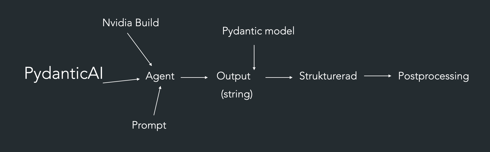
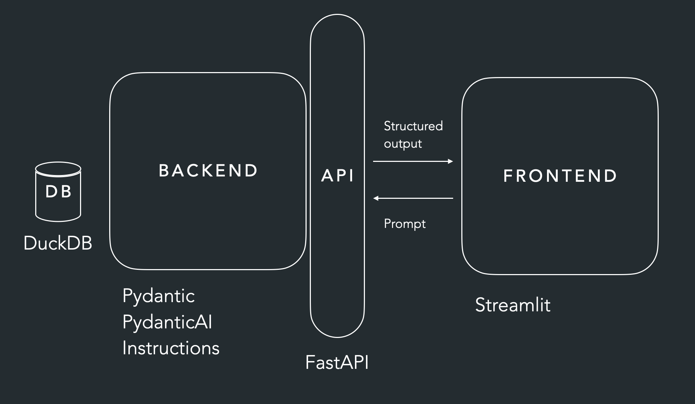

# Lecture notes – AI Ops

## Innehåll

- [Förra veckan: Structured output](#förra-veckan-structured-output)
- [Arkitektur](#arkitektur)
- [Lektion 04: Pydantic FastAPI-agent](#lektion-04-pydantic-fastapi-agent)
- [Lektion 05: Chatbot med minne](#lektion-05-chatbot-med-minne)
- [Lektion 06: Pydantic Tools](#lektion-06-pydantic-tools)
- [Felsökning](#felsökning)

---

## Förra veckan: Structured output

- Bygga en AI-agent med två olika NVIDIA-modeller
- Testa att prompta på olika sätt
- Hämta text/data från STI och strukturera den med hjälp av agenten
- Spara resultatet i en `.csv`-fil



---

## Arkitektur



Hur delarna hänger ihop (Streamlit-frontend, FastAPI-backend, AI-agent):

```text
Streamlit (frontend.py)
    │  httpx.post  →  { question, message_history }
    ▼
FastAPI (api.py)  →  validerar med ChatRequest
    ▼
chat_agent.py  →  Agent.run()  →  LLM
    ▼
FastAPI  →  ChatResponse { response, message_history }
    ▼
Streamlit visar svaret och sparar historiken i st.session_state
```

---

## Lektion 04: Pydantic FastAPI-agent

### Kopiera en fil till en annan mapp

```bash
cd <work_folder>
cp ../<folder_name>/<file_name> .
```

### Skapa agenten och testa den i terminalen

1. Skapa agenten med vald modell och lägg till `instructions`.
2. Testa agenten direkt i terminalen.

**I scriptet:**

```python
movie = movie_agent.run_sync("meddelande till agenten")
print(movie.output)
```

**I terminalen:**

```bash
uv run agent.py
```

### Strukturerad output

- Skapa en `BaseModel` för output-formatet och definiera vilka fält du vill ha med.
- Skicka modellen till agenten via `output_type`.

```python
from pydantic import BaseModel
from pydantic_ai import Agent

class Movie(BaseModel):
    title: str
    year: int

movie_agent = Agent(MODEL, output_type=Movie)
```

### Testa endpointen

Skapa en endpoint med `@app.get("/...")` och starta servern:

```bash
uv run uvicorn api:app --reload
```

Testa sedan i webbläsaren på `http://127.0.0.1:8000/docs` (Swagger UI).

---

## Lektion 05: Chatbot med minne

I lektion 04 kunde vi skicka in en fråga till AI-agenten (t.ex. be om en film) och få ett svar, men agenten **kom inte ihåg något** mellan anropen. Det löser vi nu.

### 1. Skapa agenten med en modell

| Inställning     | Används till                                         |
| --------------- | ---------------------------------------------------- |
| `system_prompt` | Sätts en gång och ändras inte (personlighet, regler) |
| `instructions`  | Kan ändras över tid                                  |

### 2. Skapa minne för chatboten

Använd `message_history` tillsammans med `result.all_messages()`:

```python
result = await chat_agent.run("....", message_history=result.all_messages())
```

> **Varför?** LLM:er och HTTP-API:er är tillståndslösa. Historiken måste skickas med vid varje anrop.

- `result.all_messages()` = hela samtalet
- `result.new_messages()` = bara meddelandena från det senaste anropet

### chat_agent.py

```python
from pydantic_ai import Agent
from constants import MODEL
from dotenv import load_dotenv
from data_models import ChatRequest, ChatResponse

load_dotenv()  # Läser in API-nyckeln från .env

chat_agent = Agent(
    MODEL,
    system_prompt="Be a joking programming nerd, always answer with a programming joke. "
    "Also add in some emojis to make it funnier.",
)


async def chat(request: ChatRequest):
    result = await chat_agent.run(
        request.question, message_history=request.message_history
    )

    return ChatResponse(response=result.output, message_history=result.all_messages())
```

### data_models.py

`ModelMessage` är Pydantic AI:s typ för ett meddelande i en konversation (användartext, system prompt, modellsvar, verktygsanrop). Genom att skicka med listan "minns" agenten tidigare meddelanden.

```python
from pydantic import BaseModel, Field
from pydantic_ai import ModelMessage


class ChatRequest(BaseModel):
    question: str = Field(
        description="users message or question to JokeBot",  # Visas i /docs
    )

    message_history: list[ModelMessage] = []  # Tom lista = nytt samtal

    model_config = {
        # Exempel som visas i Swagger/OpenAPI – här kan man lägga till fler exempelfrågor
        "json_schema_extra": {"example": {"question": "Tell me a joke about Python"}}
    }


class ChatResponse(BaseModel):
    response: str = Field(
        description="The JokeBot's response including a programming joke and emojis"
    )

    message_history: list[ModelMessage]  # Klienten sparar och skickar tillbaka denna
```

### api.py

```python
from fastapi import FastAPI
from chat_agent import chat
from data_models import ChatResponse, ChatRequest

app = FastAPI()


@app.post("/chat", response_model=ChatResponse)
async def joke_chat(request: ChatRequest):
    chat_response = await chat(request)
    return chat_response
```

### frontend.py (Streamlit)

- `st.session_state` sparar data mellan omkörningar (Streamlit kör om hela scriptet vid varje interaktion).
- Frontend skickar `question` + `message_history` till `/chat` med `httpx.post`.
- Sätt en längre `timeout`, eftersom LLM-anrop ofta tar mer än 5 sekunder.

```python
response = httpx.post(
    "http://127.0.0.1:8000/chat",
    json={"question": prompt, "message_history": st.session_state.message_history},
    timeout=60,
).json()
```

### Starta allt (två terminaler)

```bash
# Terminal 1: backend
uv run uvicorn api:app --reload

# Terminal 2: frontend
uv run streamlit run frontend.py
```

---

## Lektion 06: Pydantic Tools

Verktyg (tools) låter agenten anropa vanliga Python-funktioner, t.ex. för att slå en tärning eller hämta data.

| Dekorator                  | När den används                                   |
| -------------------------- | ------------------------------------------------- |
| `@agent.tool_plain`        | Verktyg som **inte** behöver kontext              |
| `@agent.tool`              | Verktyg som behöver kontext (`RunContext`, `deps`) |

> **Tips:** Docstringen i funktionen skickas till modellen och förklarar för den vad verktyget gör. Skriv den tydligt.

```python
import random as rnd
from pydantic_ai import Agent, RunContext

# deps_type anger vilken typ av data (dependencies) som skickas in vid körning
dice_agent = Agent(
    MODEL,
    deps_type=str,
    system_prompt="Du spelar ett tärningsspel. Använd verktygen för att slå tärningen "
    "och för att ta reda på spelarens namn.",
)


# Verktyg utan kontext
@dice_agent.tool_plain
def role_dice() -> str:
    """Roll a 20 sided die and return the result"""
    return str(rnd.randint(1, 20))


# Verktyg med kontext
@dice_agent.tool
def get_player_name(ctx: RunContext[str]) -> str:
    """Get the player's name"""
    return ctx.deps  # Värdet som skickades in via deps=


# Kör agenten (await fungerar i Jupyter; i vanligt script, använd run_sync)
dice_result = await dice_agent.run("I guess 16", deps="Lisa")

dice_result.output
```

---

       |